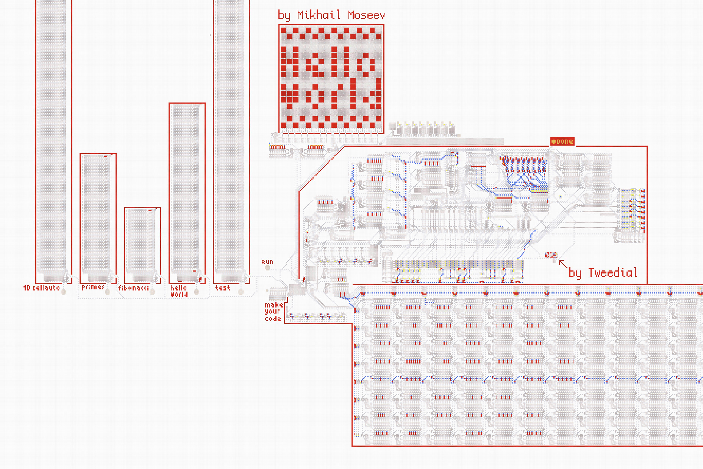

<h1>Компьютер в демо-версии стрелочек в стиме</h1>

<table>
  <tr>
    <td>
      
Демонстрация работы:

      <ol>
        <li>Зайдите на карту и нажмите на дискету Hello World</li>
        <li>Дождитесь загрузки программы в память</li>
        <li>Нажмите RUN</li>
        <li>Наблюдайте, как программа выведет "Hello world" и загорится лампочка Done</li>
      </ol>
      
<a href="https://logic-arrows.io/map-J6sKCafg">Карта</a>

      
<a href="https://github.com/mihail-moseev/computer-for-the-Steam-version/blob/main/devices%20and%20specifications/devices%20and%20specifications.md">Устройства и характеристики</a>

      
<a href="https://github.com/mihail-moseev/computer-for-the-Steam-version/blob/main/programs.md">Готовые программы</a>

    </td>
    <td>
      
    </td>
  </tr>
</table>
