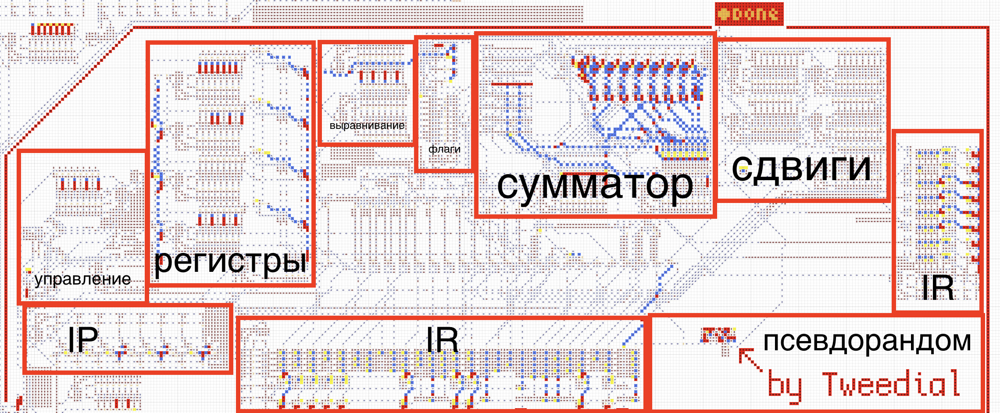
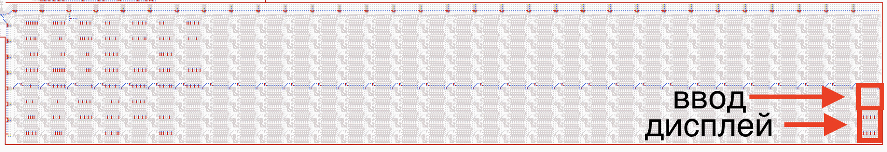
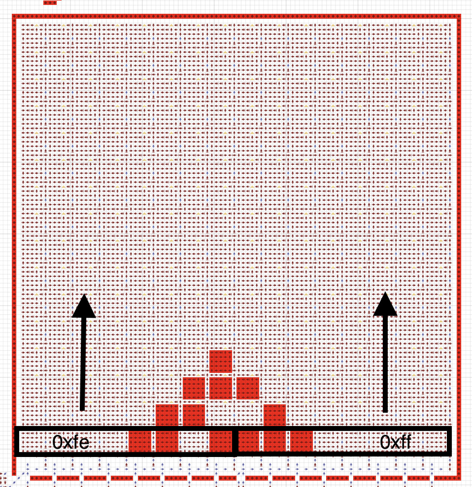
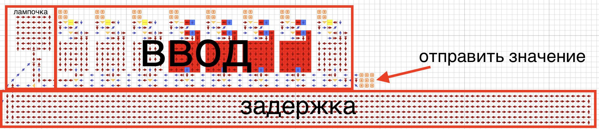

# Устройства и характеристики компьютера

## Процессор

8-ми битная архитектура

4 регистра: a, b, c, d

4 флага: Z (ноль), S (знак), C (перенос/беззнаковое переполнение), O (знаковое переполнение)

Используется псевдорандом, сделанный Tweedial

Чтобы написать свою программу, выполните следующие шаги:

1. Изучите архитектуру процессора
2. Перейдите на [онлайн компилятор](https://chubrik.github.io/arrows-compiler/#out=moseev)
3. В левой части напишите программу
4. Справа скопируйте код дискеты
5. Вставьте дискету на карту с компьютером
6. Соедините провод дискеты с общим проводом
7. Нажмите на кнопку, чтобы загрузить дискету
8. Нажмите RUN и смотрите за выполнением программы

[Подробнее](https://github.com/chubrik/LogicArrows/blob/main/ru/computer-v2/programming.md)

## Память

Объём памяти: 256 байт

Единицей хранимой информации является 1 байт

Адрес доступа к памяти так же представляет собой 1 байт

## Дисплей

Для вывода байта на правую половину дисплея необходимо сохранить его по адресу `0xff`

Для вывода байта на левую половину дисплея необходимо сохранить его по адресу `0xfe`

При сохранении байта на любую половину все байты на этой половине смещаются вверх

Это позволяет легко расширять дисплей бесконечно в высоту

Дисплей подключён всегда, при загрузке программы байты не отображаются

## Ввод

Имеет задержку, которая позволяет прочитать байт без багов.

Чтобы отправить значение, следуйте инструкции:

1. Введите значение, нажимая на кнопки сверху (старший бит слева)
2. Ждите, когда загорится лампочка
3. После этого отправьте значение, нажав на кнопку слева

Чтобы прочитать ввод в программе, необходимо прочитать адрес `0xfd`

После этого программа остановится и будет ждать ввода пользователя

Когда пользователь отправит значение, оно сохранится в регистр

Далее ввод можно будет обработать
